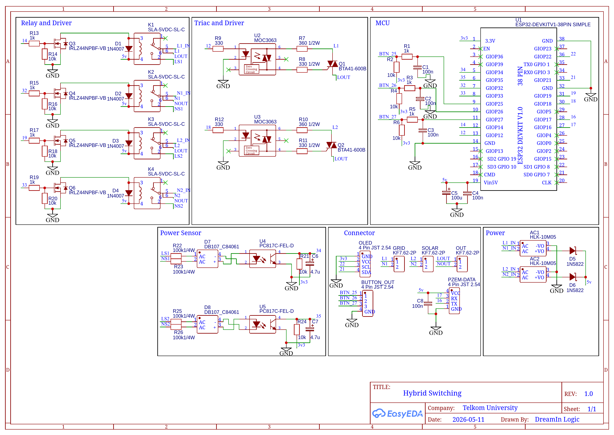

# ⚡ Intelligent Hybrid ATS Microgrid System 

An advanced, real-time Automatic Transfer Switch (ATS) for Microgrid Systems (Grid & Solar PV) powered by an **ESP32**. This system leverages **FreeRTOS** for deterministic multitasking and utilizes **Fuzzy Logic** to make intelligent switching decisions based on power quality and time periods. It also features real-time cloud datalogging via Google Sheets.

## ✨ Key Features
* **Real-Time Multitasking (FreeRTOS):** Efficiently divides CPU workloads (Telemetry, UI, Control, and Cloud Logging) across ESP32's Dual Cores using Mutexes to prevent data corruption.
* **Fuzzy Logic Decision Making:** Evaluates Voltage, Frequency, and Anomaly Duration to calculate the health score of the active power source and decides the optimal time to switch.
* **Zero-Delay Emergency Switch:** Instantly isolates the main source and transfers to the backup source (< 1 sec) when a total blackout (< 5V) is detected.
* **Cloud Datalogging:** Securely streams telemetry data (V, Hz, W, Fuzzy Score, State) to Google Sheets via HTTPS for research and analytical purposes. 
* **Interactive UI:** 0.96" OLED display with a custom menu system and WiFi Manager configuration portal.

## 🛠️ Hardware Requirements
* **Microcontroller:** ESP32 (NodeMCU / DevKitC)
* **Power Sensor:** PZEM-004T v3.0 (Modbus TTL)
* **Actuators:** 2-Channel Relay Module (Active Low/High)
* **Display:** 0.96" OLED I2C (SSD1306)
* **Input:** 3x Push Buttons (Page, Mode, Toggle)
* **Power Supply:** 220V AC to 5V DC Step-Down Module (e.g., Hi-Link HLK-PM01)

## 📐 Schematic & Wiring Diagram

**Pin Configuration:**
| Component | ESP32 Pin | Note |
| :--- | :--- | :--- |
| **PZEM RX/TX**    | GPIO 16 / GPIO 17 | Hardware Serial 2 |
| **OLED SDA/SCL**  | GPIO 21 / GPIO 22 | I2C Bus |
| **Relay GRID**    |       GPIO X      | *(Update with your actual pin)* |
| **Relay SOLAR**   |       GPIO Y      | *(Update with your actual pin)* |
| **Btn Page**      |       GPIO A      | 10k Pull-Up |
| **Btn Mode**      |       GPIO B      | 10k Pull-Up |
| **Btn Toggle**    |       GPIO C      | 10k Pull-Up |

## 🧠 Software Architecture (FreeRTOS)
The system is divided into 4 independent tasks running concurrently on two cores:

1. **`taskSwitchingControl` (Core 1):** The brain of the system. Runs the Fuzzy Logic inference engine and handles the mechanical relay switching. It runs with the highest priority to ensure rapid response during emergency blackouts.
2. **`taskReadTelemetry` (Core 1):** Communicates with the PZEM-004T via Hardware Serial to fetch real-time V, I, P, and Hz.
3. **`taskUpdateUI` (Core 0):** Manages the OLED display and button debounce logic. Runs on Core 0 to avoid blocking the main control loop.
4. **`taskDataStream` (Core 0):** Sleeps for most of the cycle to save CPU time. Wakes up every 10 seconds to send data payloads securely to a Google Apps Script Web App. 

## 🚀 Installation & Setup
1. Clone this repository.
2. Open the project in **VS Code** with the **PlatformIO** extension.
3. Ensure the required libraries are listed in your `platformio.ini` (e.g., `Adafruit SSD1306`, `PZEM-004T v30`, `WiFiManager`).
4. **Google Sheets Setup:** 
   * Deploy your Google Apps Script as a Web App.
   * Copy the generated deployment URL.
   * Paste the URL into `src/main.cpp` inside the `googleScriptURL` variable.
5. Compile and upload to the ESP32.

## ⚙️ How to Use
1. **Power On:** The system will start in AP Mode if no known WiFi is found.
2. **Connect to WiFi:** Connect your phone to `ATS_Microgrid_AP` and enter your local network credentials.
3. **Operation Modes:** 
   * **AUTO:** System switches automatically based on the Fuzzy Logic engine.
   * **MANUAL:** Override the AI and force the source to GRID or PV via the Settings Menu.
   * **EMERGENCY (LOCKED):** Automatically triggered during a blackout. Data streaming is locked to preserve dataset integrity.

## 📄 License
This project is for research and educational purposes.